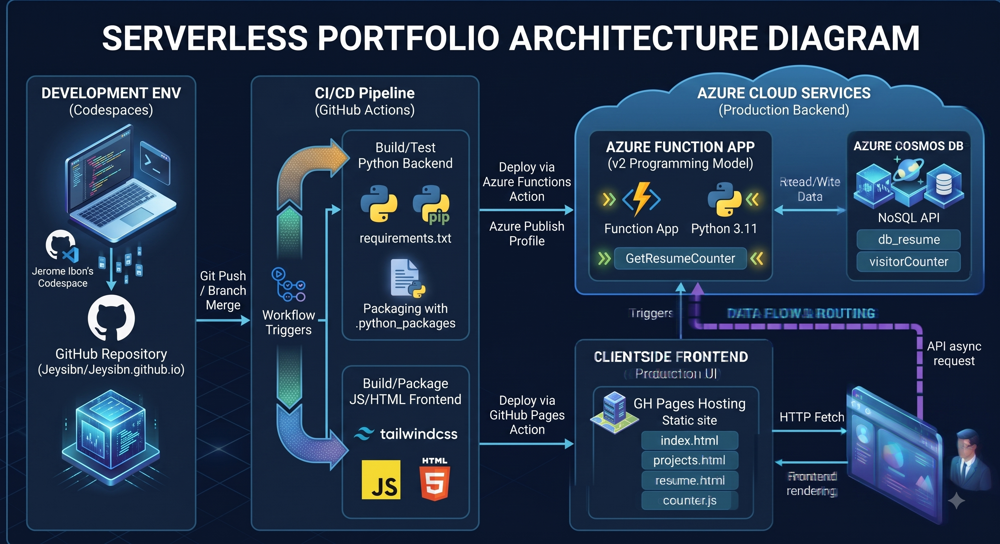

# Cloud-Backed Portfolio

[](https://github.com/Jeysibn/portfolio/actions/workflows/dev-ci.yml)
[](https://github.com/Jeysibn/portfolio/actions/workflows/pr-main.yml)
[](https://developer.hashicorp.com/terraform)
[](https://azure.microsoft.com/)

A production-oriented Cloud and DevOps portfolio built as an end-to-end engineering project. The deployed system combines a React + TypeScript single-page frontend, Python Azure Functions APIs, Azure Cosmos DB, Terraform-managed infrastructure, Azure-native observability, a provider-neutral AI portfolio assistant, and GitHub Actions CI/CD using OpenID Connect (OIDC) authentication to Azure.

The frontend uses a monochrome "Engineered Simplicity, Quiet Motion" system modelled on a near-black, grainy poster look: condensed uppercase display type (Big Shoulders Display) over Barlow, tracked eyebrow labels, rounded charcoal cards, pill controls, and a name-first hero. Light and dark themes are both designed and follow the visitor's system preference until they choose. It keeps interactive project details, skill explanations, credentials, resume download, the visitor counter, the AI assistant, and an opportunity-focused contact experience while remaining portfolio-first. The redesign is staged; see [`docs/redesign/MASTER_PLAN.md`](docs/redesign/MASTER_PLAN.md).

The assistant uses the same canonical project facts as the website. It currently
answers about all four visible projects with deterministic lightweight retrieval,
curated source links, bounded scope, and no vector database or repository-wide
ingestion.

## Live Project

- **Portfolio:** https://jeysibn.github.io/
- **Source repository:** https://github.com/Jeysibn/portfolio
- **Pages repository:** https://github.com/Jeysibn/jeysibn.github.io
- **GitHub:** https://github.com/Jeysibn
- **LinkedIn:** https://www.linkedin.com/in/jeromeibon

## Architecture



| Layer | Technology | Responsibility |
|---|---|---|
| Frontend | React, TypeScript, Vite, GitHub Pages | Single-page portfolio UI, visitor counter, AI chat, project evidence, toolkit, credentials, resume |
| Backend | Azure Functions, Python 3.11 | Health, visitor-counter, and AI-assistant APIs |
| Database | Azure Cosmos DB for NoSQL | Persistent visitor count, hashed visitor records, chat rate-limit records |
| AI | OpenAI-compatible external API | Portfolio-specific conversational assistant with provider-neutral frontend branding |
| Observability | Application Insights + Log Analytics | Requests, latency, failures, exceptions, structured operational events, deployment troubleshooting |
| Infrastructure | Terraform + AzureRM | Azure resource provisioning and lifecycle management |
| CI/CD | GitHub Actions | Typechecking, builds, tests, security checks, Terraform planning, production deployment, smoke verification |
| Cloud authentication | GitHub OIDC + Microsoft Entra ID | Short-lived Azure authentication without stored client secrets |

For the full system walkthrough, see [`docs/architecture.md`](docs/architecture.md).

## Repository Structure

```text
portfolio/
├── .github/
│   ├── dependabot.yml
│   └── workflows/
│       ├── dev-ci.yml
│       ├── pr-main.yml
│       ├── frontend-deploy.yml
│       ├── backend-deploy.yml
│       └── terraform-deploy.yml
├── content/
│   └── portfolio.json             # canonical shared portfolio content
├── backend/
│   ├── assistant/
│   ├── data/                      # generated approved assistant projection
│   ├── evals/                     # offline assistant evaluations
│   ├── tools/                     # knowledge builder/validator
│   ├── tests/
│   ├── function_app.py
│   ├── host.json
│   └── requirements.txt
├── docs/
│   ├── architecture.md
│   ├── azure-oidc.md
│   ├── cicd.md
│   ├── observability.md
│   ├── runbook.md
│   └── Changelog.md
├── frontend/
│   ├── app/
│   │   ├── public/
│   │   ├── src/
│   │   │   ├── App.tsx
│   │   │   ├── api.ts
│   │   │   ├── hooks.ts
│   │   │   ├── portfolio.ts
│   │   │   ├── skill-details.ts
│   │   │   ├── styles.css
│   │   │   └── main.tsx
│   │   ├── index.html
│   │   ├── package.json
│   │   ├── tsconfig.json
│   │   └── vite.config.ts
│   └── assets/
├── terraform/
├── CONTRIBUTING.md
├── SECURITY.md
└── README.md
```

The generated production site is published to the separate `Jeysibn/jeysibn.github.io` repository. That repository is a deployment target, not the source of truth for application development.

## Frontend

The portfolio is a single React page built from `frontend/app/`. Navigation uses document anchors, so the application does not require a client-side router or static-hosting fallback rules.

Current frontend features include:

- responsive desktop and mobile navigation with active-section tracking;
- a compact saved Light/Dark theme control with system preference used as the initial fallback;
- a name-first hero headed by **Jerome Christian Ibon**, with Cloud Support, DevOps, and Cloud Engineering as supporting positioning;
- an explicit open-to-opportunities status with entry-level role context;
- API status and visitor counter in the footer, each with loading and unavailable states;
- AI assistant with session history, rate-limit/error handling, bounded timeout/cancellation, and a closed state that does not block page interaction;
- assistant starter questions that populate the input without auto-submitting, subtle factual source links, clear/reset behavior, and accessible loading/error states;
- a static project index showing all four projects at once, with Homelab GitOps and the Cloud-Backed Portfolio featured and MoniKey and NOC Report Builder listed as currently building, each with a case-study button and public repository link;
- full SVG architecture diagrams with text equivalents in each project's case-study dialog;
- static-host-safe project inspection links using `?project=<slug>` and browser history synchronization;
- skills grouped by domain as plain buttons, each opening a detailed explanation dialog;
- restrained certification and education lists with canonical issuer/status links;
- a concise on-page resume with direct PDF download and a form-less recruiter handoff;
- quiet, one-shot motion (hero entrance, scroll reveal, card lift, link arrows, a case-study flow trace) built with CSS and a small IntersectionObserver hook, no animation library, no continuous decorative animation, and full `prefers-reduced-motion` support;
- an ordered flow trace at the top of each case study, taken from the canonical `architectureFlows`;
- old `#about` links redirect to the top of the page;
- a responsive layout checked from 320px to 1920×1080.

The primary page flow is:

```text
Hero → Work → Experience → Toolkit → Credentials → Resume → Contact
```

Navigation scrolls the requested section to the top of the content viewport beneath the sticky header, and no navigation entry is forced active while the user remains in the hero.

### Project architecture loading

Projects use two presentation levels:

1. Each project card shows a one-line flow taken from the project's typed preview data.
2. The case-study dialog loads the complete SVG architecture set and exposes a text equivalent for each diagram.

The cards keep the first scan compact while preserving detailed evidence on demand.

### Local frontend development

Use Node.js **22.12+**. Node 18 is unsupported by the current Vite toolchain.

```bash
cd frontend/app
npm ci
npm run dev
```

If `nvm` is available, a Node 22 runtime can be selected before installing dependencies.

The production Azure Functions API is used by default. To target a local Function host, create a local `.env` from `.env.example`:

```text
VITE_API_BASE_URL=http://localhost:7071/api
```

Validation and production build:

```bash
npm run typecheck
npm run lint
npm test -- --run
npm run build
npm run perf:budget
PLAYWRIGHT_SKIP_BUILD=1 npm run test:ui
```

The browser suite runs against the production Vite preview and covers 1920×1080,
1440×900, mobile Chromium, important dialogs/overlays, reduced motion, deep
links, and targeted axe scans. A clean `npm run test:ui` run can build
automatically through the Playwright web-server configuration.

Vite writes the deployable artifact to `frontend/app/dist/`.

### Production-style local frontend test

Do not compare the number of requests produced by `npm run dev` directly with the deployed site. Vite development mode intentionally serves individual source modules and React Fast Refresh support.

For a production-style local comparison:

```bash
npm run build
npm run preview
```

Then open the Vite preview server, enable **Disable cache** in browser developer tools, and perform a hard reload. The resulting request graph more closely represents the bundled production artifact.

## CI/CD Model

The repository uses two long-lived branches:

```text
dev  → development and integration
main → protected production
```

### Development

A push to `dev` or pull request targeting `dev` validates:

- React dependency installation;
- strict TypeScript typecheck;
- ESLint and frontend unit tests;
- Vite production build and artifact verification;
- the JavaScript performance budget;
- Playwright browser and axe accessibility tests against the production preview;
- Python dependency compatibility, syntax, Ruff, and backend tests;
- canonical knowledge projection validation and offline assistant retrieval evaluations;
- Terraform formatting, backend-disabled initialization, and validation;
- final `Development CI Passed` gate.

### Pull Request to `main`

A `dev → main` pull request runs production-readiness checks including frontend build packaging, backend validation/security auditing, Azure Function deployment-package creation, Azure OIDC authentication, Terraform remote-backend initialization, a real authenticated Terraform plan, and the final `Production Ready` gate.

No application or infrastructure mutation occurs from the pull request itself.

### Production

Frontend publication repeats the frontend checks, including the performance
budget and production-preview Playwright/axe gate, before synchronizing the
generated artifact to `Jeysibn/jeysibn.github.io`. A deployed Pages smoke test
remains after publication. Production source maps are not published because no
private source-map upload or monitoring consumer is configured.

After merge into `main`, path-specific workflows deploy only the affected layer:

```text
frontend/** or content/** → Vite build → Jeysibn/jeysibn.github.io → root-site smoke check
backend/** or content/**  → Azure Functions → health + visitor API smoke tests
terraform/** → Terraform plan + apply
```

Frontend publication works as follows:

```text
Jeysibn/portfolio main
        |
        | frontend change
        v
Vite build (`frontend/app/dist`)
        |
        | PAGES_DEPLOY_TOKEN
        v
Jeysibn/jeysibn.github.io main
        |
        v
https://jeysibn.github.io/
```

The workflow checks out the dedicated Pages repository, synchronizes `dist/` into it with `rsync --delete`, creates `.nojekyll`, commits the generated site when content changed, pushes `main`, and verifies the root production URL.

Azure workflows continue to authenticate using GitHub-issued OIDC tokens. The Pages publishing token is a separate GitHub credential and is not used for Azure access.

See [`docs/cicd.md`](docs/cicd.md).

## Security Design

Key security decisions include:

- GitHub OIDC federation with Microsoft Entra ID for Azure Actions authentication;
- no reusable Azure service-principal client secret in GitHub;
- a system-assigned Function App identity with a Cosmos DB native RBAC role assignment; connection-string mode remains the Terraform default until production identity cutover is verified;
- protected `main` branch with required PR validation;
- separate OIDC trust subjects for pull-request planning and production environment deployment;
- a scoped `PAGES_DEPLOY_TOKEN` used only to publish the generated frontend into `Jeysibn/jeysibn.github.io`;
- hashed client IP addresses before persistence in Cosmos DB;
- AI provider API key stored in GitHub Actions Secrets and passed to Terraform as a sensitive `TF_VAR` input;
- Terraform state stored remotely in Azure Blob Storage and treated as sensitive;
- backend dependency auditing in PR validation;
- local environment and secret files excluded from Git;
- generated TypeScript build caches (`*.tsbuildinfo`) excluded from Git;
- lazy AI-client initialization so optional AI failures cannot prevent unrelated Function routes from being indexed;
- canonical content is allow-listed and validated into a generated assistant artifact; repository files are never automatically ingested;
- assistant telemetry contains retrieval/source/version/latency metadata but not raw prompts, full conversations, plaintext IPs, or secrets;
- no provider API keys or Azure connection strings embedded in the React bundle.

Application-secret flow:

```text
GitHub Actions Secret: OPENCODE_API_KEY
        |
        v
TF_VAR_opencode_api_key
        |
        v
Terraform sensitive variable
        |
        v
Azure Function App application setting
```

See [`docs/azure-oidc.md`](docs/azure-oidc.md) and [`SECURITY.md`](SECURITY.md).

## Backend Local Development

Prerequisites:

- Python 3.11+
- Azure Functions Core Tools
- Terraform
- Azure CLI
- Node.js 22.12+

```bash
cd backend
python -m venv .venv
source .venv/bin/activate
python -m pip install --upgrade pip
pip install -r requirements.txt
```

Create `backend/local.settings.json` locally with the required application settings. The file is ignored by Git.

```json
{
  "IsEncrypted": false,
  "Values": {
    "AzureWebJobsStorage": "UseDevelopmentStorage=true",
    "FUNCTIONS_WORKER_RUNTIME": "python",
    "COSMOS_DB_AUTH_MODE": "connection_string",
    "CosmosDbConnectionString": "<local-or-development-connection-string>",
    "OPENCODE_API_KEY": "<api-key>"
  }
}
```

Run and validate:

```bash
func start

cd backend
ruff check .
pytest -v
```

Terraform validation without touching shared remote state:

```bash
cd terraform
terraform fmt -check -recursive
terraform init -backend=false
TF_VAR_subscription_id=00000000-0000-0000-0000-000000000000 terraform validate
```

Terraform constrains AzureRM to `~> 5.0` and commits the provider lockfile.
The 3.x → 4.x → 5.x upgrade was reviewed in sequence, with the matching
provider migration guides and a production-state plan required before apply.
Weekly Terraform updates are opened for review through Dependabot. Do not use a
production `terraform apply` as a local validation step.

## Terraform Remote State

Remote state is stored in Azure Blob Storage:

```text
Resource group:  rg-terraform-state
Storage account: sttfstatejeysibn
Container:       tfstate
State key:       portfolio.terraform.tfstate
```

Because Terraform manages sensitive Function App settings, access to the remote backend is restricted and state contents must not be exposed in logs or public troubleshooting output.

## Azure Resources Managed by Terraform

Terraform currently provisions:

- Azure Resource Group;
- Function App Storage Account;
- Azure Cosmos DB account;
- Cosmos DB SQL database (`PortfolioDB`);
- `Counter` container;
- `VisitorIPs` container with TTL;
- Linux Consumption App Service Plan;
- Python 3.11 Azure Function App;
- system-assigned Function identity and Cosmos DB native data-plane role assignment;
- Log Analytics workspace with cost guardrails;
- workspace-based Application Insights;
- Function App configuration, telemetry connection, and CORS settings.

## Observability and Operations

Production visibility includes:

- `GET /api/health` liveness endpoint;
- safe health release metadata (`version`, deployment `revision`, environment);
- Application Insights request, failure, exception, and latency telemetry;
- structured application events and correlation IDs;
- Log Analytics with 30-day retention and a `0.1 GB/day` ingestion cap;
- non-mutating backend liveness and revision post-deployment verification;
- frontend root-site post-publication verification;
- initial SLI/SLO targets and KQL troubleshooting queries.

See [`docs/observability.md`](docs/observability.md) and [`docs/runbook.md`](docs/runbook.md).

## Documentation

- [`docs/architecture.md`](docs/architecture.md) — system design and data flows
- [`docs/cicd.md`](docs/cicd.md) — branch model and GitHub Actions pipelines
- [`docs/observability.md`](docs/observability.md) — telemetry, health semantics, cost guardrails, SLOs, and KQL
- [`docs/azure-oidc.md`](docs/azure-oidc.md) — Azure federation design and trust subjects
- [`docs/runbook.md`](docs/runbook.md) — deployment, troubleshooting, rollback, and recovery procedures
- [`docs/Changelog.md`](docs/Changelog.md) — release history
- [`CONTRIBUTING.md`](CONTRIBUTING.md) — development workflow and validation commands
- [`SECURITY.md`](SECURITY.md) — security model and reporting guidance

## Project Goals

This repository is both a live portfolio and a learning project focused on practical Cloud and DevOps engineering:

- cloud architecture;
- infrastructure as code;
- CI/CD and protected releases;
- workload identity and secret management;
- typed frontend applications against serverless APIs;
- remote state management;
- observability and post-deployment verification;
- accessible frontend interaction design;
- frontend performance and asset-delivery discipline;
- testing and validation;
- operational documentation.

## License

This project is licensed under the MIT License. See [`LICENSE`](LICENSE).
